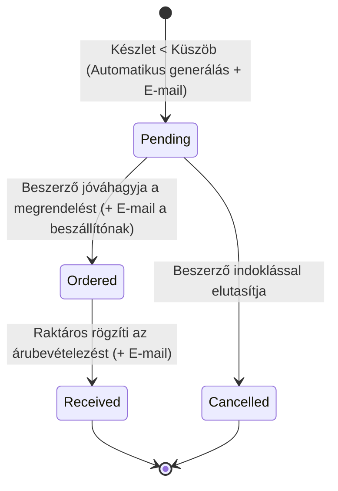
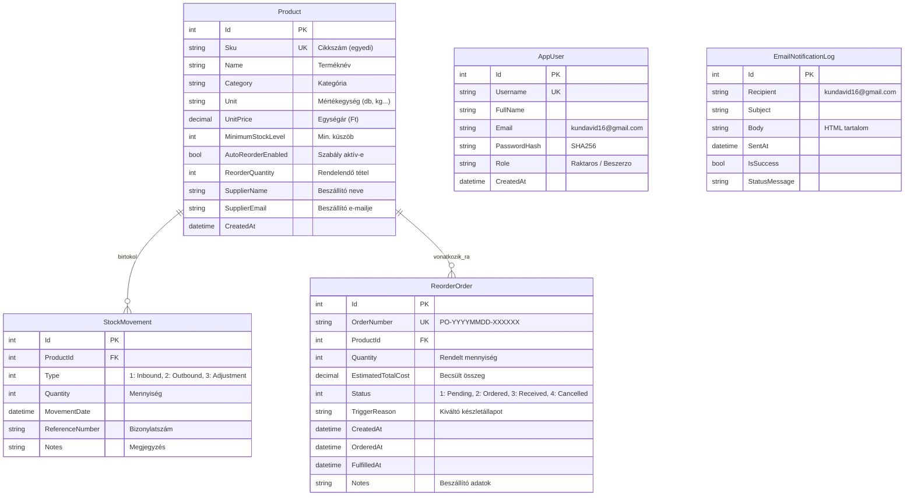

# 📦 InventoryManager - Raktár- és Készletnyilvántartó Rendszer

Professzionális, rétegzett architektúrájú raktárkészlet-kezelő és automatizált beszerzési rendszer **ASP.NET Core 8.0 MVC**, **Entity Framework Core**, **SQLite**, szerepkör alapú hitelesítés (**Raktáros** és **Beszerző**), **automatikus utánrendelési szabálymotor** és **külső e-mail értesítő** alrendszer támogatásával.

---

## 📑 Tartalomjegyzék

1. [Projekt Áttekintés & Célkitűzés](#-projekt-áttekintés--célkitűzés)
2. [Technológiai Stack](#-technológiai-stack)
3. [Rendszerarchitektúra & Tervezési Minták](#-rendszerarchitektúra--tervezési-minták)
4. [Szerepkörök és Jogosultsági Mátrix](#-szerepkörök-és-jogosultsági-mátrix)
5. [Üzleti Szabályok és Működési Logika](#-üzleti-szabályok-és-működési-logika)
6. [Adatmodell és Adatbázis Séma](#-adatmodell-és-adatbázis-séma)
7. [Külső E-mail Értesítő Rendszer](#-külső-e-mail-értesítő-rendszer)
8. [Felhasználói Felület és Modulok](#-felhasználói-felület-és-modulok)
9. [Telepítés és Futtatás](#-telepítés-és-futtatás)
10. [Automatizált Egységtesztek (xUnit)](#-automatizált-egységtesztek-xunit)
11. [Demó Fiókok és Gyors Belépés](#-demó-fiókok-és-gyors-belépés)

---

## 🎯 Projekt Áttekintés & Célkitűzés

Az **InventoryManager** célja egy modern vállalat raktári folyamatainak teljes körű digitalizálása:
- Terméktörzsadatok és beszállítói partnerek kezelése.
- Pontos, valós idejű készletszintek és készletértékek nyilvántartása.
- Árubevételezések és raktári kiadások szigorú készletfedezeti ellenőrzése (negatív készletbe futás kizárása).
- **Proaktív készletvédelem:** automatikus beszerzési javaslatok generálása, amint egy termék készlete a minimális küszöb alá esik.
- **Azonnali értesítési lánc:** külső e-mailes riasztás a felelősök és a beszerzés felé (`kundavid16@gmail.com`).

---

## 🛠️ Technológiai Stack

- **Keretrendszer:** .NET 8.0 (C# 12)
- **Webes keretrendszer:** ASP.NET Core MVC (Model-View-Controller)
- **Adatkezelés / ORM:** Entity Framework Core 8.0 (Code-First megközelítés)
- **Adatbázis:** SQLite (önálló, zero-configuration beágyazott adatbázis: `inventory.db`)
- **Hitelesítés & Jogosultságkezelés:** ASP.NET Core Cookie Authentication & Role-based Authorization (`[Authorize(Roles = "...")]`)
- **Biztonság:** SHA256 jelszóhashelés, CSRF / Antiforgery token védelem minden űrlapon
- **Levelezés:** `System.Net.Mail` SMTP kliens (Google Gmail TLS/SSL támogatással) és in-app szimulált kézbesítési napló
- **Frontend / UI:** Bootstrap 5, Bootstrap Icons, HTML5, reszponzív flexbox kártyák és modális előnézetek
- **Tesztrendszer:** xUnit, Microsoft.EntityFrameworkCore.InMemory, Moq

---

## 🏛️ Rendszerarchitektúra & Tervezési Minták

A rendszer szigorúan követi a tiszta, rétegzett architektúra elveit és a felelősségek szétválasztását (Separation of Concerns):

```text
InventoryManager/
│
├── InventoryManager.sln
│
├── src/InventoryManager.Web/                      # Prezentációs és Alkalmazási réteg
│   ├── Controllers/                               # HTTP kérések fogadása, validáció, válaszok
│   │   ├── AccountController.cs                   # Bejelentkezés, kijelentkezés, gyors demó belépés
│   │   ├── InventoryController.cs                 # Készlet áttekintő, Árubevételezés, Készletkiadás, Mozgásnapló
│   │   ├── NotificationsController.cs             # Kiküldött e-mailek felügyelete, tesztküldés
│   │   ├── ProductsController.cs                  # Terméktörzsadatok és termék adatlapok
│   │   └── ReordersController.cs                  # Utánrendelések és beszerzés felügyelete
│   │
│   ├── Services/                                  # Üzleti Logikai Réteg (Business Logic)
│   │   ├── IAuthService.cs & AuthService.cs       # Felhasználó-hitelesítés
│   │   ├── IEmailNotificationService.cs           # E-mail értesítő szolgáltatás
│   │   │   └── EmailNotificationService.cs
│   │   ├── IInventoryService.cs                   # Készletkalkuláció, beérkezés, kiadásfedezet
│   │   │   └── InventoryService.cs
│   │   ├── IPasswordHasher.cs & PasswordHasher.cs # Biztonságos SHA256 hashelés
│   │   ├── IProductService.cs & ProductService.cs # Terméktörzs és SKU egyediség
│   │   └── IReorderService.cs & ReorderService.cs # Automatikus szabálymotor és beszerzési rendelések
│   │
│   ├── Models/                                    # Perzisztens Entitások (Domain Entities)
│   │   ├── AppUser.cs                             # Felhasználó és szerepkör
│   │   ├── EmailNotificationLog.cs                # E-mail audit napló
│   │   ├── MovementType.cs                        # Enum: Inbound, Outbound, Adjustment
│   │   ├── Product.cs                             # Termék és utánrendelési szabálymezők
│   │   ├── ReorderOrder.cs                        # Utánrendelési megrendelés
│   │   ├── ReorderStatus.cs                       # Enum: Pending, Ordered, Received, Cancelled
│   │   └── StockMovement.cs                       # Készletmozgási tétel
│   │
│   ├── ViewModels/                                # Megjelenítési és űrlap modellek
│   ├── Views/                                     # Razor (.cshtml) reszponzív nézetek
│   ├── Data/
│   │   ├── InventoryDbContext.cs                  # EF Core adatbázis kontextus
│   │   └── DbInitializer.cs                       # Automatikus adatbázis-létrehozás és mintaadatok
│   ├── appsettings.json                           # Kapcsolati sztring és EmailSettings konfiguráció
│   └── Program.cs                                 # DI regisztráció, middleware pipeline
│
└── tests/InventoryManager.Tests/                  # Tesztréteg (Unit Tests)
    ├── AuthServiceTests.cs                        # Hitelesítés és hashelés tesztjei
    ├── EmailNotificationServiceTests.cs           # E-mail küldés és naplózás tesztjei
    ├── InventoryServiceTests.cs                   # Készletmozgások és negatív készlet elleni védelem tesztjei
    ├── ProductServiceTests.cs                     # Termékkreálás és unikalitás tesztjei
    └── ReorderServiceTests.cs                     # Szabálymotor (szigorúan küszöb alatt) tesztjei
```

---

## 👥 Szerepkörök és Jogosultsági Mátrix

A rendszer szerepkör-alapú hozzáférés-vezérlést (RBAC) valósít meg mind a Controller végpontok szintjén (`[Authorize(Roles = "...")]`), mind a grafikus felületen (csak az engedélyezett gombok és menüpontok renderelődnek):

| Funkció / Képernyő | Raktáros (`Raktaros`) | Beszerző (`Beszerzo`) | Megjegyzés |
| :--- | :---: | :---: | :--- |
| **Készletlista & Dashboard** | ✅ Megtekintés | ✅ Megtekintés | Valós idejű készlet, készletérték |
| **Termék Adatlap & Történet** | ✅ Megtekintés | ✅ Megtekintés | Részletes specifikáció, mozgások |
| **Készletmozgások Naplója** | ✅ Megtekintés | ✅ Megtekintés | Szűrés termékekre |
| **Új Beérkezés (Bevételezés)** | 🔒 **Csak Raktáros** | ❌ Nincs jog | Raktári áruátvétel és készletnövelés |
| **Készletkiadás** | 🔒 **Csak Raktáros** | ❌ Nincs jog | Nem mehet negatívba a készlet! |
| **Új Termék Felvétele** | ❌ Nincs jog | 🔒 **Csak Beszerző** | Cikkszám, ár, szabályok megadása |
| **Utánrendelési Szabályok** | ❌ Nincs jog | 🔒 **Csak Beszerző** | Küszöb, tételnagyság, beszállító |
| **Utánrendelés Jóváhagyása** | ❌ Nincs jog | 🔒 **Csak Beszerző** | Státuszváltás: *Ordered* (Megrendelve) |
| **Szabályok Kézi Futtatása** | ❌ Nincs jog | 🔒 **Csak Beszerző** | Azonnali ellenőrzés lefutása |
| **E-mail Értesítések Naplója**| ✅ Megtekintés | ✅ Megtekintés | Kiküldött levelek és tesztküldés |

---

## ⚖️ Üzleti Szabályok és Működési Logika

### 1. Készlet nem lehet negatív
A raktári készletmozgások könyvelése szigorú elszámolású:
$$\text{Aktuális Készlet} = \sum \text{Inbound} - \sum \text{Outbound} + \sum \text{Adjustment}$$
- Kiadás rögzítése előtt az `InventoryService` lekéri a pillanatnyi készletet.
- Amennyiben a kiadandó mennyiség nagyobb, mint az elérhető raktárkészlet ($\text{Készlet} - \text{Kiadás} < 0$), a rendszer **megtagadja a kiadást**, és `InvalidOperationException` kivételt dob.
- A felhasználó felületén piros figyelmeztetés jelenik meg, jelezve a hiányt.

### 2. Utánrendelés SZIGORÚAN a küszöb ALATT keletkezik
- A rendszerben minden termékhez beállítható egy minimális készletküszöb (`MinimumStockLevel`).
- **A szabály feltétele:**
  $$\text{Aktuális Készlet} < \text{MinimumStockLevel}$$
  - **Példa:** Ha a küszöb 5 db:
    - Készlet = 6 db $\rightarrow$ Megfelelő készlet, nincs teendő.
    - Készlet = 5 db $\rightarrow$ Pontosan a határon van, **még NEM keletkezik utánrendelés**.
    - Készlet = 4 db $\rightarrow$ Szigorúan a küszöb alatt van, **azonnal keletkezik az utánrendelés és az e-mail értesítő**.

### 3. Duplikációvédelem
- Amíg egy adott termékre létezik nyitott utánrendelés (`Pending` vagy `Ordered` státusszal), a rendszer **nem hoz létre újabb rendelést**, elkerülve a felesleges raktári túlkészletezést.

### 4. Beszerzési Életciklus és Automatikus Lezárás


---

## 🗄️ Adatmodell és Adatbázis Séma

Az adatbázis SQLite-ban tárolódik (`inventory.db`), az alábbi relációs táblákkal:



---

## 📧 Külső E-mail Értesítő Rendszer

Az alkalmazás minden kritikus raktári és beszerzési eseményről formázott HTML értesítést készít a **`kundavid16@gmail.com`** címre:

1. **Események, amelyek e-mailt küldenek:**
   - ⚠️ **Automatikus utánrendelés generálása:** Amint a készlet a küszöb alá esik, e-mail tájékoztatja a beszerzőt a hiányról, a javasolt tételnagyságról és a beszállítóról.
   - 🚚 **Megrendelés jóváhagyása:** Értesítés a rendelés beszállító felé történő továbbításáról.
   - 📦 **Új árubevételezés:** Értesítés a raktárba beérkezett új tételekről.

### ⚙️ Konfiguráció (`appsettings.json`)

```json
"EmailSettings": {
  "SenderName": "InventoryManager Rendszer",
  "SenderEmail": "noreply@inventorymanager.local",
  "RecipientEmail": "kundavid16@gmail.com",
  "SmtpServer": "smtp.gmail.com",
  "SmtpPort": 587,
  "EnableSsl": true,
  "Username": "",
  "Password": "",
  "EnableRealSending": false
}
```

### 💡 Miért nem küldött levelet az `EnableRealSending: true` beállítással?
A Google (Gmail) **szigorú biztonsági protokollja** miatt a `smtp.gmail.com` szerver nem engedélyezi a névtelen (unauthenticated) küldést és a sima fiókjelszó használatát sem:
- Ha az `EnableRealSending: true`, de a `Username` vagy a `Password` üres maradt, a rendszer ezt a hibát mostantól **kiemelt figyelmeztetéssel jelzi az Értesítések felületén**.

### 🔑 Valós Gmail küldés beállítása 2 perc alatt (Google Alkalmazásjelszó):
1. Lépj be a Google fiókodba: [Google Fiók Biztonság](https://myaccount.google.com/security).
2. Győződj meg róla, hogy a **2 lépcsős azonosítás** be van kapcsolva.
3. Keress rá az oldal tetején lévő keresőben: **Alkalmazásjelszavak** (*App Passwords*).
4. Adj meg egy nevet (pl. `InventoryManager`), majd kattints a **Létrehozás** gombra.
5. A Google generál egy **16 betűs jelszót** (pl. `abcd efgh ijkl mnop`).
6. Másold be az `appsettings.json` fájlba:
   ```json
   "Username": "kundavid16@gmail.com",
   "Password": "abcd efgh ijkl mnop",
   "EnableRealSending": true
   ```
7. Indítsd el a rendszert, és kattints az **Értesítések** menüpontban a **"Teszt e-mail küldése most"** gombra!

> [!NOTE]
> **Fejlesztői / Védési mód (`EnableRealSending: false`):** Ha nem szeretnél valós SMTP-t konfigurálni, az alkalmazás akkor is 100%-ban működik! Minden generált e-mail rögzítésre kerül az adatbázisban, és a webes felületen az **"Értesítések"** oldalon teljes HTML előnézettel megtekinthető.

---

## 🖥️ Felhasználói Felület és Modulok

1. **Készlet áttekintő (`/Inventory/Index`):**
   - 4 db statisztikai kártya: Összes termék, Raktáron lévő összmennyiség, Raktárkészlet összértéke (Ft), Figyelmeztetések száma.
   - Készletlista táblázat színes állapotjelző badge-ekkel:
     - 🟢 **Rendben:** Készlet $\ge$ Minimális szint.
     - 🟡 **Alacsony készlet:** Készlet $<$ Minimális szint (utánrendelés szükséges).
     - 🔴 **Elfogyott:** Készlet $\le 0$.
2. **Új beérkezés rögzítése (`/Inventory/Receive` - Raktáros):**
   - Termékválasztó lenyíló menü, mennyiség, bizonylat / szállítólevélszám, megjegyzés.
   - Mentéskor automatikusan lezárja a nyitott beszállítói rendelést.
3. **Készletkiadás rögzítése (`/Inventory/Issue` - Raktáros):**
   - Készletcsökkentés azonnali fedezetellenőrzéssel (megakadályozza a negatív készletet).
   - Kiadás után azonnal lefut az automatikus utánrendelési ellenőrzés.
4. **Termékek kezelése (`/Products` - Beszerző):**
   - Terméktörzs lista, új termék felvétele, árak, minimális küszöb, utánrendelési darabszám és beszállító megadása.
5. **Utánrendelések felügyelete (`/Reorders` - Beszerző):**
   - Generált és függőben lévő megrendelések listája.
   - Szűrés státusz szerint (*Pending*, *Ordered*, *Received*, *Cancelled*).
   - "Automatikus szabályok futtatása most" gomb.
   - Rendelés jóváhagyása a beszállító felé.
6. **Értesítések Naplója (`/Notifications`):**
   - Az összes kiküldött / generált levél listája dátummal, státusszal és modális HTML előnézettel.
   - SMTP beállítási diagnosztika és teszt e-mail gomb.

---

## 🚀 Telepítés és Futtatás

### Előfeltételek:
- [.NET 8.0 SDK](https://dotnet.microsoft.com/download/dotnet/8.0) telepítése.

### Futtatás lépései:
1. Nyiss egy terminált a projekt webes mappájában:
   ```powershell
   cd "C:\Users\mrkda\OneDrive\Asztali gép\7. félév\Web-es Alkalmazások (JAVA vagy C#)\InventoryManager\src\InventoryManager.Web"
   ```
2. Indítsd el az alkalmazást:
   ```powershell
   dotnet run
   ```
3. Nyisd meg a konzolban kiírt címet a böngészőben (alapértelmezett: `http://localhost:5224` vagy `https://localhost:7034`).
4. Az adatbázis (`inventory.db`) és a mintaadatok az első indításkor automatikusan felépülnek.

---

## 🧪 Automatizált Egységtesztek (xUnit)

A projekt átfogó egységteszt-készlettel rendelkezik, amely fedi a teljes üzleti logikát:

```powershell
cd "C:\Users\mrkda\OneDrive\Asztali gép\7. félév\Web-es Alkalmazások (JAVA vagy C#)\InventoryManager"
dotnet test
```

### Tesztek lefedettsége:
- **`InventoryServiceTests`:**
  - Sikeres bevételezés készletnöveléssel.
  - Negatív vagy 0 mennyiség elutasítása.
  - Nem létező termék hibakezelése.
  - Sikeres kiadás készletcsökkentéssel.
  - **Negatív készletbe futás szigorú megakadályozása** (`RecordIssueAsync_StockWouldBecomeNegative_ThrowsInvalidOperationException`).
  - Készletösszesítők és raktárkészlet-érték precíz számítása.
- **`ReorderServiceTests`:**
  - **Utánrendelés generálása szigorúan a küszöb alatt** (`CheckAndGenerateAutoReordersAsync_StockStrictlyBelowMinimum_...`).
  - **Küszöbbel egyenlő készlet esetén NEM generálódik rendelés** (`CheckAndGenerateAutoReordersAsync_StockEqualToMinimum_...`).
  - Duplikált rendelés megakadályozása, ha már van aktív megrendelés.
  - Letiltott utánrendelési szabály tiszteletben tartása.
  - Rendelés jóváhagyása státuszváltással és e-mail triggerrel.
  - Kiadás általi közvetlen azonnali triggerelés ellenőrzése.
- **`EmailNotificationServiceTests`:**
  - E-mail naplózás és szimulált kézbesítés ellenőrzése.
  - Valós SMTP mód hibajelzése, ha hiányoznak a hitelesítési adatok.
  - Árubevételezési értesítő tartalmának és formázásának ellenőrzése.
- **`AuthServiceTests` & `ProductServiceTests`:**
  - Sikeres bejelentkezés `kundavid16@gmail.com` ellenőrzéssel.
  - Helytelen jelszó elutasítása.
  - Cikkszám (SKU) unikalitás és kis-/nagybetű normalizálás.

**Teszteredmény:** `Passed: 21, Failed: 0, Duration: < 300 ms` (100% zöld).

---

## 🔑 Demó Fiókok és Gyors Belépés

A bejelentkezési képernyőn egykattintásos gombokkal azonnal átváltható a felület a két szerepkör között:

| Felhasználónév | Jelszó | Szerepkör | E-mail cím |
| :--- | :--- | :--- | :--- |
| **`raktaros`** | `Raktar123!` | Raktáros | `kundavid16@gmail.com` |
| **`beszerzo`** | `Beszerzo123!` | Beszerző | `kundavid16@gmail.com` |
